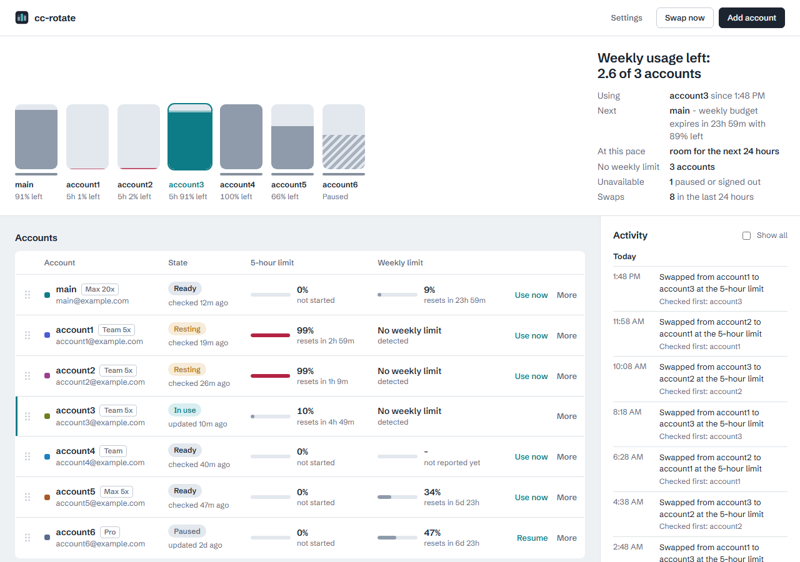

# cc-rotate

Run one Claude Code profile on a pool of your own Claude accounts.
When the account in use gets close to one of its usage limits, cc-rotate switches the profile to another account in place.
Running sessions keep going on their next request, with no restart and no proxy.

Because every session lives in one profile, sessions can see and message each other, and their history lives in one place.



> **Unofficial.** cc-rotate is a community project and is not affiliated with or endorsed by Anthropic.
> It is meant for people who personally hold more than one Claude subscription.
> You are responsible for using your accounts in line with [Anthropic's terms](https://www.anthropic.com/legal/consumer-terms) and the [Claude Code usage policy](https://code.claude.com/docs/en/legal-and-compliance).

## How it works

- Each account signs in once through Claude Code's own login page (`claude auth login`), in a scratch folder.
  cc-rotate saves that login in a local store, encrypted with a key kept in a file only you can read (details in [SECURITY.md](SECURITY.md)).
- A dedicated profile (`~/.claude-rotate`) holds the account in use.
  cc-rotate copies your existing settings, hooks, skills and plugins into it.
- Every Claude Code session in that profile runs `cc-rotate-ctl statusline` after every reply and every 30 seconds.
  It records every usage limit Claude Code reports for the account, copies renewed logins back into the store, and starts a swap at 98% of any limit.
- A swap takes the same lock Claude Code uses when it renews a login, saves the outgoing account's latest login, and writes the next account's login into the profile.
  Claude Code notices the change and uses the new account on its next request.
- If a request already hit the limit, Claude Code waits and retries on its own, and the retry goes out on the new account.
- Before picking an account, cc-rotate also reads the last usage Claude Code saw in each of your other Claude Code profiles, so an account an agent used up in its own profile is not picked.
  If an account still turns out to be used up right after a swap, cc-rotate moves on at once instead of waiting out the 2-minute minimum between swaps.

cc-rotate never talks to Anthropic itself.
All traffic is the unmodified Claude Code talking to Anthropic, exactly as it does today.

The design, with the Claude Code behavior it relies on, is in [docs/specs/2026-10-24-cc-rotate.md](docs/specs/2026-10-24-cc-rotate.md).

## Platforms

| | Windows 10 and 11 | Linux | macOS |
|---|---|---|---|
| Rotation | Supported, verified with real accounts | Supported; Claude Code keeps its login in the same file as on Windows | Experimental, not yet verified on a Mac |
| Desktop app | Supported | Builds; needs a desktop with a system tray | Builds; runs as a plain executable, not an app bundle |
| Data folder | `%LOCALAPPDATA%\cc-rotate` | `~/.local/share/cc-rotate` | `~/Library/Application Support/cc-rotate` |

`~` is your home folder (`%USERPROFILE%` on Windows).

On macOS, Claude Code keeps its login in the Keychain rather than in a file, and cc-rotate swaps the Keychain item.
Claude Code rereads that item at most every 30 seconds, so a swap reaches running sessions within about 30 seconds instead of on their next request.
Start Claude Code with `cc-rotate` there: the Keychain item is named after the exact profile path, which `cc-rotate` sets for you.
If you try it on a Mac, `cc-rotate-ctl doctor` shows where the login lives, and reports of what works and what does not are very welcome.

## Requirements

- Claude Code, native install (`claude --version`). Tested with 2.1.310.
- To build from source: [Rust](https://rustup.rs) 1.85 or newer, and [Node.js](https://nodejs.org) 20 or newer for the desktop app.
- On Linux, the desktop app also needs the WebKitGTK and tray libraries, for example on Debian and Ubuntu: `sudo apt install libwebkit2gtk-4.1-dev libayatana-appindicator3-dev librsvg2-dev`.

## Install

On Windows, in PowerShell:

```powershell
git clone https://github.com/mattmarcin/cc-rotate
cd cc-rotate
.\scripts\install.ps1
```

On Linux or macOS:

```sh
git clone https://github.com/mattmarcin/cc-rotate
cd cc-rotate
sh scripts/install.sh
```

The script builds `cc-rotate`, `cc-rotate-ctl` and the desktop app `cc-rotate-app`, copies them to `~/.local/bin`, and creates the rotation profile from `~/.claude`.

| Windows | Linux and macOS | What it does |
|---|---|---|
| `-BinDir <dir>` | `--bin-dir <dir>` | Install somewhere else. Make sure that folder is on your `PATH`. |
| `-Template <dir>` | `--template <dir>` | Copy settings from a different Claude Code profile. |
| `-SkipApp` | `--skip-app` | Install only the command-line tools (no Node.js needed). |

Running the script again upgrades the executables and leaves your rotation profile and logins alone.
On Windows it also removes the `cc-rotate` PowerShell function that older versions added, because that function would hide the new `cc-rotate` command.

## Add your accounts

Add each account once.
Either open the app (`cc-rotate-ctl dashboard`) and choose **Add account**, or use the terminal:

```sh
cc-rotate-ctl login --email you@example.com --label work
```

A browser window opens on Claude's sign-in page.
Your browser signs in as whichever claude.ai account it is currently logged in to, so switch accounts there first if needed.
A separate browser profile per account makes this painless.

The first account you add becomes the active one.

These are fresh logins, separate from any other Claude Code profiles you already use, so adding an account here never logs you out anywhere else.

If you already have a Claude Code profile per account (for example `~/.claude-work`), `cc-rotate-ctl profiles` lists them with the account each one belongs to.
`cc-rotate-ctl login --from-profile work` then signs that account in fresh, with its email and label filled in, and refuses the login if a different account signs in.
cc-rotate only reads those profiles to find out which account they belong to; it never copies or changes their logins.

## Daily use

Open a new terminal and start Claude Code on the pool:

```sh
cc-rotate
```

`cc-rotate` starts `claude` with the rotation profile and passes its arguments through, so `cc-rotate --resume <id>` and the rest work as usual, in any shell.
The status line starts with the active account's label, and your own status line still shows after it.

Start it in a project folder, not your home folder.
Claude Code does not run status lines in the home folder (trust there lasts for one run and is never saved), so cc-rotate cannot see usage or swap accounts for a session started there.
The `cc-rotate` command warns you, and `cc-rotate-ctl doctor` lists any such session.

The desktop app shows every account with its plan, how much of each limit is used, when each resets, which account is used next and why, usage over the last day or week with swaps marked, and an activity log.
It lives in the tray, starts when you sign in to your computer (you can turn that off in **Health**), and sends a notification when an account needs a new login, when no account is left to swap to, and when an account is ready again after that.

### Which account is used next

Every account has a place in your order.
Drag the handles in the app's **Accounts** table to change it, or use the arrow keys on a focused handle, or `cc-rotate-ctl order` and `cc-rotate-ctl move`.
New accounts go to the end.
After an upgrade from an older cc-rotate, accounts that had the same priority share a place until you reorder them.

When the account in use reaches a limit, cc-rotate picks the next account that is below all of its limits:

1. Accounts without a weekly limit first, then accounts whose weekly limit is not known yet, then accounts with one.
   Turn this off with `cc-rotate-ctl config prefer_no_weekly_limit false`, and only your order counts.
2. Then your order.
3. Then, between accounts in the same place, the one with the most room left.

cc-rotate finds out whether an account has a weekly limit from the usage Claude Code reports: an account that reported a weekly limit has one, and an account that went through two separate 5-hour windows in the last 8 days without ever reporting one has none.
Until then it is not known yet.
If that guess is wrong, set it yourself in the account's **More** dialog or with `cc-rotate-ctl weekly-limit <label> yes|no` (`auto` goes back to detecting it).

cc-rotate also switches back by itself: when an account that ranks above the one in use is ready again (for example once its 5-hour window has reset), it swaps to it, as long as the account in use has been in use for at least `switch_back_dwell_s` (10 minutes by default).
That includes an account you picked by hand, so pause an account if you want it left alone.
Accounts in the same place never swap just to even out usage.

`cc-rotate-ctl next --explain` lists every account in the order it would be used, with the reason for each.

cc-rotate knows how much of each limit an account has used from three places: the status line of sessions in the rotation profile, the status line of your other profiles if you turn on observe mode for them (see **Tracking your other profiles too**), and the last `/usage` reading Claude Code saved in each of your other profiles.
An account used up elsewhere since its last reading can still be picked.
When the first readings after a swap show that, cc-rotate swaps again on the next reading, without waiting for `swap_cooldown_s`.

Some limits only apply to one model, such as a weekly limit for one model family.
When Claude Code reports one, cc-rotate records it too and only counts it while your sessions use that model.

### Commands

| Command | What it does |
|---|---|
| `cc-rotate [claude arguments]` | Start Claude Code on the pool. |
| `cc-rotate-ctl status` | Every account with its plan, usage and reset times, and the next pick. |
| `cc-rotate-ctl next` | The account the next swap would pick, and why. `--explain` lists every account in order with a reason. |
| `cc-rotate-ctl swap` | Swap now to the next pick. `--to <label>` picks one. |
| `cc-rotate-ctl login` | Add an account. `--relogin <label>` signs an existing account in again. `--from-profile <name>` adds the account another profile uses. |
| `cc-rotate-ctl profiles` | List your other Claude Code profiles and the account each belongs to. |
| `cc-rotate-ctl pause <label>` / `resume <label>` | Keep an account out of rotation, or bring it back. |
| `cc-rotate-ctl rename <label> <new>` / `remove <label> --yes` | Rename or delete an account. |
| `cc-rotate-ctl order [<label>...]` | Show the order accounts are used in, or put the listed accounts first, in that order. |
| `cc-rotate-ctl move <label> --to <n>` | Move an account to place `n` in the order (1 is used first). |
| `cc-rotate-ctl weekly-limit <label> [auto\|yes\|no]` | Show or set whether an account has a weekly limit (`auto` detects it). |
| `cc-rotate-ctl events` | Recent swaps, logins and problems. |
| `cc-rotate-ctl doctor` | Check the profile, the store and Claude Code. |
| `cc-rotate-ctl backup <file>` | Print a daily backup of the profile's login file, decrypted. It contains tokens, so keep the output private. |
| `cc-rotate-ctl config [key] [value]` | Show or change settings. `--unset` restores a default. |
| `cc-rotate-ctl setup` | Create the rotation profile. `--from <dir>` picks the template, `--force` rebuilds it. `--remove-alias` removes the `cc-rotate` PowerShell function older versions added; with an existing profile, that is all it does. |
| `cc-rotate-ctl dashboard` | Open the desktop app. |

### Settings

| Setting | Default | Meaning |
|---|---|---|
| `swap_threshold_5h` | 98 | Swap when a 5-hour limit reaches this percentage. |
| `swap_threshold_7d` | 98 | Swap when a weekly limit, for all models or for one, reaches this percentage. Limits of a kind cc-rotate does not know use the lower of the two thresholds. |
| `swap_cooldown_s` | 120 | Minimum seconds between swaps caused by usage readings. |
| `prefer_no_weekly_limit` | true | Use accounts without a weekly limit before the ones with one. |
| `switch_back_dwell_s` | 600 | How long an account stays in use before cc-rotate switches back to a better ranked account that is ready again. |
| `lock_timeout_ms` | 30000 | How long a swap waits for Claude Code to finish renewing a login. |
| `sample_retention_days` | 90 | How long usage history is kept. |
| `statusline_downstream` | your old status line | The status line command shown after cc-rotate's label. |
| `profile_dir` | `~/.claude-rotate` | The rotation profile, recorded by `setup`. |
| `claude_path` | found on `PATH` | The `claude` executable to use for logins and for `cc-rotate`. |

### Tracking your other profiles too

cc-rotate already reads the usage Claude Code last saw in each of your other `~/.claude*` profiles that is signed in to an account in the pool.
Claude Code saves a reading there each time a session in that profile checks the account's usage, for example for `/usage` and when the account reaches a limit.
cc-rotate only reads those files, and only uses a reading that Claude Code marked as belonging to the account the profile is signed in to.

For a reading after every reply instead, turn on observe mode in that profile.
In its `settings.json`, set the status line to:

```json
"statusLine": { "type": "command", "command": "cc-rotate-ctl statusline --observe", "refreshInterval": 30 }
```

To keep your own status line, add it with `--then`, for example `cc-rotate-ctl statusline --observe --then \"node /path/to/statusline.js\"`.

Observe mode only records usage for accounts that are also in the pool.
It never touches that profile's login and never swaps anything.

## Using cc-rotate with herdr

[herdr](https://github.com/herdrdev/herdr) brings your panes back when it restarts and resumes the Claude Code sessions in them.
On its own it resumes them with `claude --resume <id>`, which starts them on your default profile instead of the pool.

cc-rotate fixes that with a `SessionStart` hook in the rotation profile.
When a session starts in a herdr pane, the hook tells herdr to resume it with `cc-rotate --resume <id>` instead.
When herdr restarts, the restored pane types that command into a fresh shell, so the session comes back on the pool.
When you quit Claude Code in a pane, herdr forgets the command, just as it forgets its own.

- It needs herdr 0.9.2 or newer, and `cc-rotate` on your `PATH`, since herdr types the bare command name.
- `cc-rotate-ctl setup` adds the hook.
  For a rotation profile set up before cc-rotate supported herdr, run `cc-rotate-ctl setup --force` once to add it.
- A pane is covered once its session starts, resumes, compacts or is cleared with `/clear` after the hook is in place.
- Sessions that were already running before you upgraded are not covered: herdr still resumes them with plain `claude`.
  Quit them and resume them once with `cc-rotate --resume <id>` to cover them.
- Subagents never report anything, and outside herdr the hook does nothing.
- `cc-rotate-ctl doctor` shows whether herdr is detected and whether the hook is installed.
  If herdr refuses a report, the reason goes to the log (see **Troubleshooting**).

## What it does not cover

- **The Claude desktop app.** Its Code tab passes its own login to Claude Code directly, so swapping the profile's login cannot reach it.
- **Claude Code's Windows Credential Manager storage.** Claude Code can be switched to keep its login in the Windows Credential Manager; swaps would then stop reaching running sessions. `cc-rotate-ctl doctor` fails loudly if that is on.
- **Claude Code updates.** cc-rotate relies on how Claude Code reloads its login and locks login renewal, which is not a documented interface.
  `cc-rotate-ctl doctor` and the app warn when your Claude Code version has not been tested.

## Troubleshooting

- Run `cc-rotate-ctl doctor` first.
- Errors from the status line and hooks go to `logs/cc-rotate.log` in the data folder (see **Platforms**).
- An account marked **needs login** had its login rejected by Anthropic. Sign it in again with `cc-rotate-ctl login --relogin <label>`.
- A daily encrypted backup of the profile's login file is kept in `backups` in the data folder.
  `cc-rotate-ctl backup <file>` prints one decrypted.

## Uninstall

1. Quit the app from its tray icon, and turn off **Start when I sign in** in **Health** first if you enabled it.
2. Delete `cc-rotate`, `cc-rotate-ctl` and `cc-rotate-app` (with `.exe` on Windows) from `~/.local/bin`.
3. Delete `~/.claude-rotate` (the profile) and the data folder (the store, its key and every saved login).

## Development

```sh
cd app && npm ci && npm run build && cd ..   # once: the app crate embeds app/dist, so build it before any cargo command
cd tests/interop && npm ci && cd ../..       # once: enables the lock tests against the real proper-lockfile package
cargo test --workspace                       # unit and integration tests
cd app && npx tauri dev                      # run the app with live reload
```

See [CONTRIBUTING.md](CONTRIBUTING.md) for the checks a pull request has to pass.

To try the app without real accounts, generate a demo store and point cc-rotate at it:

```sh
export CC_ROTATE_DATA_DIR=/tmp/cc-rotate-demo   # PowerShell: $env:CC_ROTATE_DATA_DIR = "$env:TEMP\cc-rotate-demo"
cargo run -p ccr-core --example demo_store
cd app && npx tauri dev
```

The workspace has three parts: `crates/ccr-core` (store, locks, swap protocol, login import), `crates/ccr-cli` (`cc-rotate` and `cc-rotate-ctl`), and `app` (the Tauri desktop app).

## License

[MIT](LICENSE)
